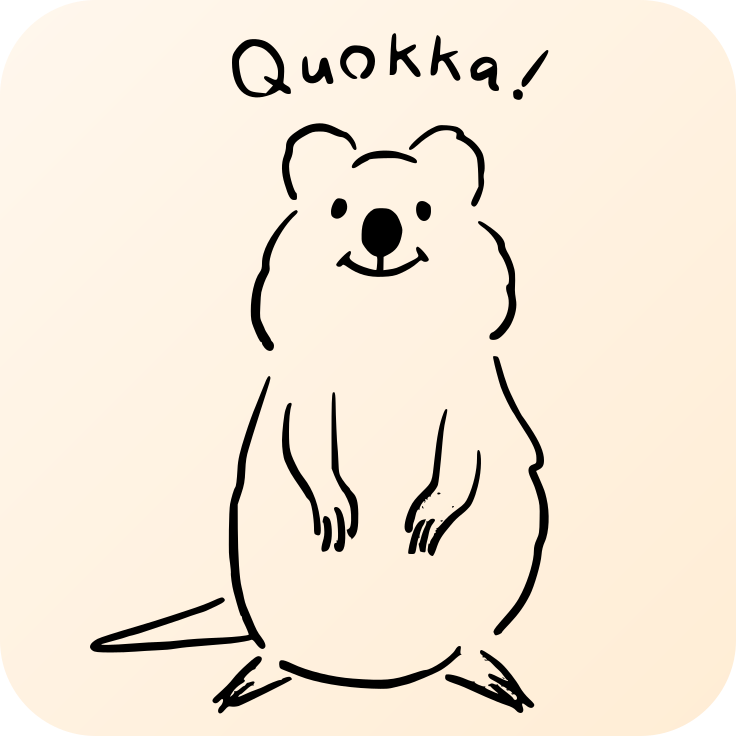

<p align="center">
  <a href="https://github.com/NICE-DEV226/quokker">
    
  </a>
</p>

<h1 align="center">Quokka</h1>

<p align="center">
  <strong>The hardware-aware AI router for your PC.</strong><br/>
  One binary. Zero configuration. Your prompts, routed to the right model in &lt; 2&nbsp;ms.
</p>

<p align="center">
  <a href="https://github.com/NICE-DEV226/quokker/blob/main/LICENSE"></a>
  <a href="https://www.rust-lang.org"></a>
  <a href="https://github.com/NICE-DEV226/quokker/actions"></a>
</p>

---

## Why Quokka

Local inference runners make you pick models by hand and happily eat every gigabyte of RAM you own. Quokka probes your machine at startup, installs the optimal **Flash + Expert** model pair, and routes every request in under **2 milliseconds** — small model for the trivial, big model for reasoning and code.

- **Hardware-aware** — probes RAM, CPU SIMD (AVX2 / AVX-512 / NEON) and GPU VRAM (CUDA / Metal / Vulkan), then picks quantizations and GPU offload (`n_gpu_layers`) automatically.
- **Memory-frugal** — `mmap`'d weights, LZ4 KV-cache eviction to disk, instant Flash ↔ Expert swaps with zero OOM risk.
- **Drop-in compatible** — OpenAI-compatible API (`/v1/chat/completions`, SSE streaming, tool calling) and a native MCP server for Cursor, Claude Code and friends.

## Quickstart

> **Status: Phase 1.** The workspace, hardware probe, model registry and Hugging Face downloader are live. The inference engine and router land in Phases 2–3 — see the [roadmap](#roadmap).

```bash
# Build from source (Rust ≥ 1.85)
cargo build --release -p quokka

# 1. Probe CPU / RAM / SIMD / GPU — shows your tier and recommended model pair
./target/release/quokka hardware
./target/release/quokka hardware --json   # machine-readable output

# 2. Download the recommended pair (or a specific target) into ~/.quokka/models
./target/release/quokka pull auto         # Flash + Expert for this machine
./target/release/quokka pull flash        # or: expert, lightweight, standard, workstation
```

Models already present in Ollama, LM Studio or the Hugging Face cache are detected and reused — Quokka never downloads a duplicate.

## CLI

| Command | Description |
| --- | --- |
| `quokka hardware [--json]` | Probe the host and print the hardware profile, tier and recommended model pair |
| `quokka pull <target>` | Download GGUF models — `auto`, `flash`, `expert`, or a tier name |

## Documentation

- [`docs/ARCHITECTURE.md`](docs/ARCHITECTURE.md) — full engineering specification
- [`docs/adr/`](docs/adr/) — architecture decision records
- [`registry/profiles.json`](registry/profiles.json) — hardware tier → GGUF model mapping

## Roadmap

| Phase | Scope | Status |
| --- | --- | --- |
| 1 | Hardware probe, tier registry, GGUF discovery, HF downloader | ✅ Done |
| 2 | `quokka-core` — `llama.cpp` FFI, `mmap` loading, OpenAI SSE API | 🚧 In progress |
| 3 | Sub-2ms router, LZ4 KV-cache, `MemoryPressureFallback` | Planned |
| 4 | MCP server, embedded Web UI, cross-compiled releases | Planned |

## Repository layout

```
crates/
  quokka-hardware/   hardware probe, auto-tuner, registry, HF downloader, GGUF discovery
  quokka-core/       (Phase 2) llama.cpp FFI, mmap, KV-cache
  quokka-router/     (Phase 3) < 2ms intent classifier
  quokka-server/     (Phase 4) OpenAI API, MCP, embedded Web UI
  quokka-telemetry/  (Phase 4) metrics
cli/                 `quokka` binary (clap)
registry/            profiles.json — hardware → GGUF mapping
benches/             criterion benchmarks
brand/               mascot & brand assets
docs/                ARCHITECTURE.md + ADRs
```

## Contributing

Issues and pull requests are welcome. The engineering bar is defined in [`docs/ARCHITECTURE.md` §8](docs/ARCHITECTURE.md): zero panics in production, `clippy -D warnings` clean, router latency strictly under 2 ms.

```bash
cargo test --workspace
cargo clippy --workspace --all-targets -- -D warnings
cargo bench -p quokka-benches
```

## License

[Apache-2.0](LICENSE)
